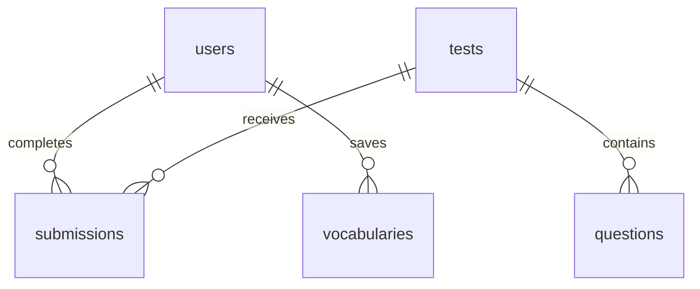

# BandUp Backend (Foundation)

Backend scaffold for an IELTS learning app. **Node.js 22+ / TypeScript / Express 5 / PostgreSQL 16 / Prisma 6.19**.

This is the **foundation** task only: DB schema, migration, connection, health check and tooling. Authentication, scoring, and CRUD endpoints are **not yet implemented**.

## 1. Requirements

- Node.js >=20.19 (recommended Node.js 22 LTS) and npm
- Docker Desktop with `docker compose`
- Free host ports `3000` and `5432` (customizable through `.env`)

## 2. Run locally

From the `backend/` directory:

```bash
# macOS/Linux
cp .env.example .env
# Windows PowerShell: Copy-Item .env.example .env
```

**Edit `.env` before running anything outside your own development machine.** Use a unique, nontrivial `POSTGRES_PASSWORD` and update the password segment of `DATABASE_URL` accordingly; URL-encode special characters. `.env` is gitignored. Never commit it.

```bash
# Start PostgreSQL in a persistent Docker volume
docker compose up -d db
# Install dependencies (generates package-lock.json on first run)
npm install
# Validate schema and apply committed migration (development)
npm run db:validate
npm run db:migrate
# Generate Prisma Client (explicit step)
npm run db:generate
# Start backend with hot reload
npm run dev
```

Open `http://localhost:3000/health`:

```json
{"status":"ok","database":"connected"}
```

Health returns `503` when the DB is down. The backend refuses to start if it cannot reach PostgreSQL.

On a second terminal:

```bash
npm run test:smoke
npm run test:contracts
npm run lint
npm run typecheck
npm run build
```

PowerShell smoke test alternative:

```powershell
Invoke-RestMethod http://localhost:3000/health
```

## 3. Migrations and database checks

The initial migration is committed under `prisma/migrations/20261029000000_init/`. Do **not** reset a DB containing valuable data.

```bash
npm run db:status
npm run db:verify  # directly verifies five tables and four foreign keys via SQL
# inspect five base tables in public schema
docker compose exec db psql -U bandup -d bandup -c "\dt public.*"
# inspect foreign keys
docker compose exec db psql -U bandup -d bandup -c "SELECT conrelid::regclass AS table_name, conname FROM pg_constraint WHERE contype='f' ORDER BY 1,2;"
```

Change the `psql -U` and `-d` values if you changed `.env`. For **deployment / CI**, use `npm run db:deploy` instead of `db:migrate`; it only applies committed migration files. When changing the schema, run `npx prisma migrate dev --name describe_change` in development, review the SQL, and commit both schema and migration. To inspect in a GUI, run `npm run db:studio`.

## 4. Entity relationships



| Table | Purpose | Notable constraints |
|---|---|---|
| `users` | Profile and IELTS goals | Unique `email`, password hash nullable for third-party authentication |
| `tests` | IELTS/placement tests | `type` and `status` enum |
| `questions` | Questions in a test | FK `test_id` → `tests.id` (CASCADE), unique `(test_id, position)` |
| `submissions` | A user's attempts | FKs `user_id` → `users.id` (CASCADE), `test_id` → `tests.id` (RESTRICT) |
| `vocabularies` | User-saved vocabulary | FK `user_id` → `users.id` (CASCADE), unique `(user_id, word)` |

Each primary key is a PostgreSQL UUID (`gen_random_uuid()`). Dates are stored as `timestamp(3)` without timezone by Prisma's default convention, except `expected_exam_date` which is a PostgreSQL `DATE`. Store UTC timestamps in application code; migrate to `@db.Timestamptz` if timezone-sensitive persistence is needed.

Answers, answer keys, options and feedback are **JSONB** to support multiple IELTS exercise formats. The `answer_key` is **sensitive grading data**; future API handlers must never return it to test-takers before grading. `password_hash` must only hold a slow salted password hash (e.g. Argon2id) if local authentication is later implemented. No raw passwords should be stored.

PostgreSQL `CHECK` constraints in the SQL migration protect score/range fields; Prisma's schema language does not model them directly. If the ERD changes, update schema and migrations accordingly.

## 5. Folder tree

```text
backend/
├── .env.example
├── .gitignore
├── docker-compose.yml
├── eslint.config.mjs
├── package.json
├── tsconfig.json
├── prisma/
│   ├── schema.prisma
│   └── migrations/
│       ├── migration_lock.toml
│       └── 20261029000000_init/migration.sql
├── src/
│   ├── app.ts
│   ├── server.ts
│   └── config/
│       ├── env.ts
│       └── database.ts
├── scripts/verify-db.mjs
├── scripts/smoke.mjs
└── tests/contracts.test.mjs
```

## 6. Troubleshooting

- `P1001` / cannot connect DB: verify Docker Desktop is on, `docker compose ps`, host port and `DATABASE_URL` match.
- `EADDRINUSE`: change `PORT` or `POSTGRES_PORT` and keep `DATABASE_URL` in sync.
- `P3005` existing schema: do not blindly reset; baseline with a reviewed migration plan.
- Prisma types not found: run `npm run db:generate` after `npm install`.
- Changed `POSTGRES_PASSWORD` but login fails: an **existing** Docker volume keeps its original DB credentials; update password within PostgreSQL or create a new volume **only if its data is disposable**. Don't use `docker compose down -v` with valuable data.
- Prisma 6 is pinned for predictable `schema.prisma` / Client setup. Prisma 7 uses a different configuration and adapter approach, so do not upgrade only one of `prisma` and `@prisma/client`.

## Scope limitations

The source Architecture Docs / definitive ERD were **not supplied** as part of this request, so the schema here is an initial interpretation of the five named entities. Confirm field definitions, role/permissions, deletes, and submission scoring against the official ERD before team integration. Some test formats may later benefit from a normalized `submission_answers` table, but it is deliberately outside the five-table scope.
